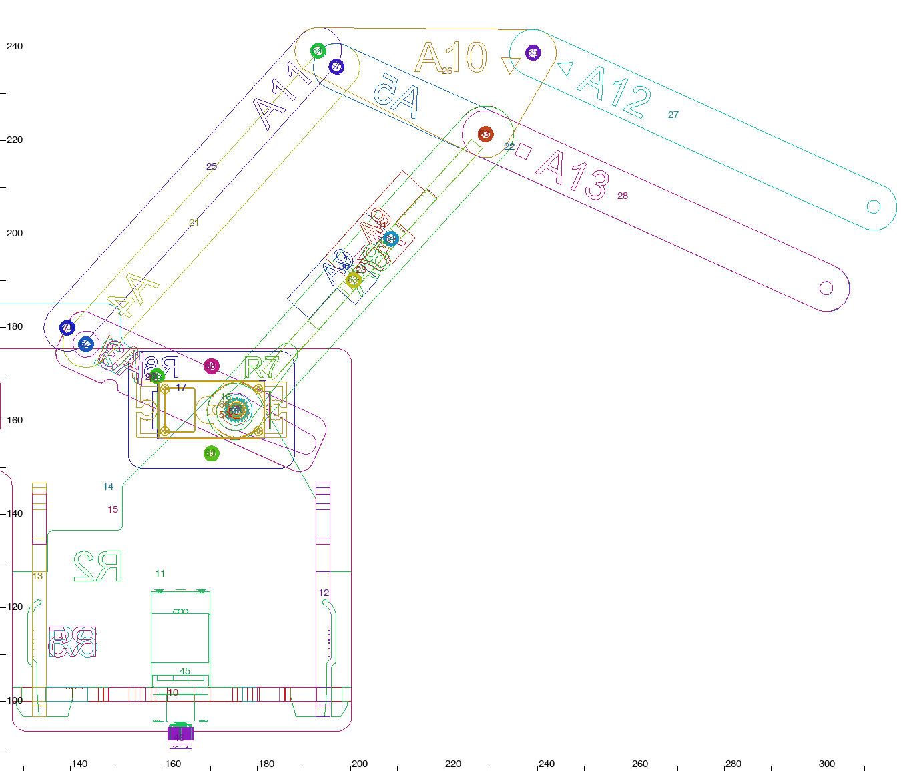
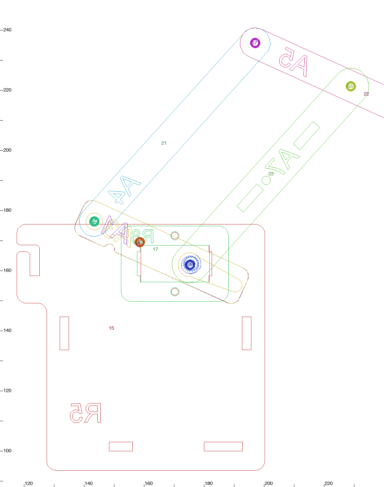
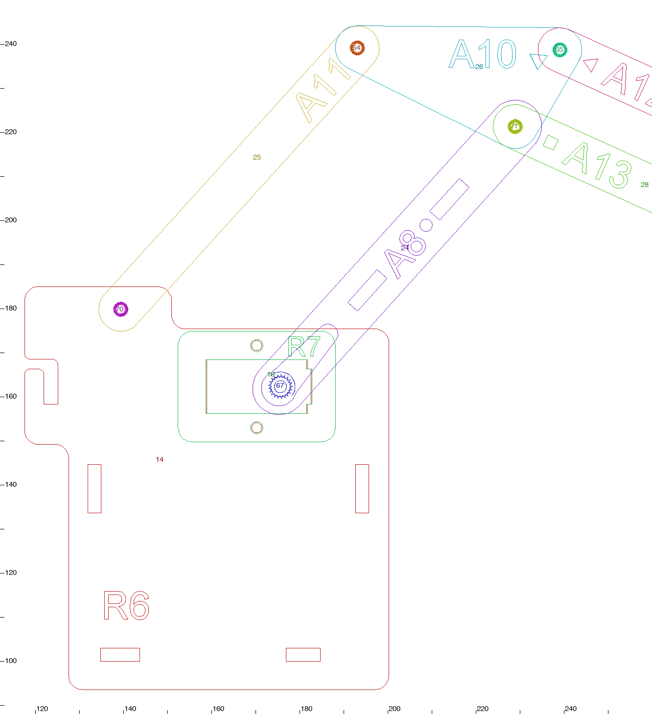
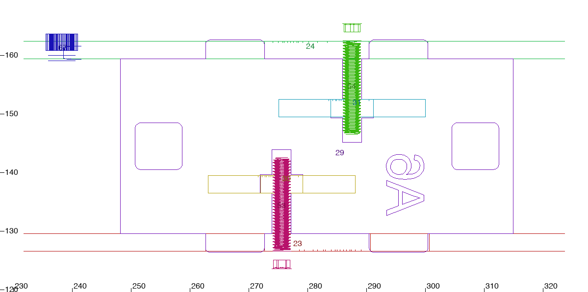
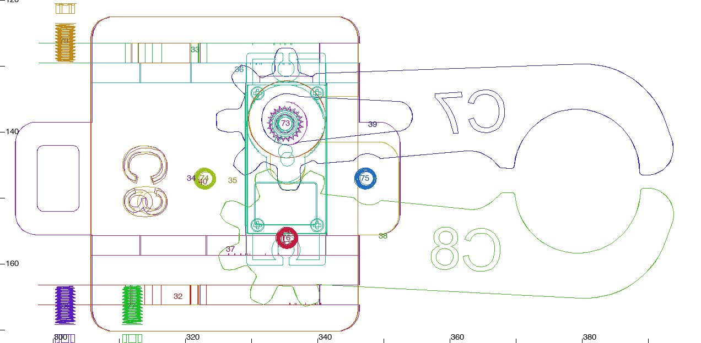
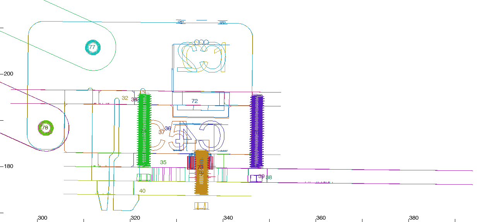
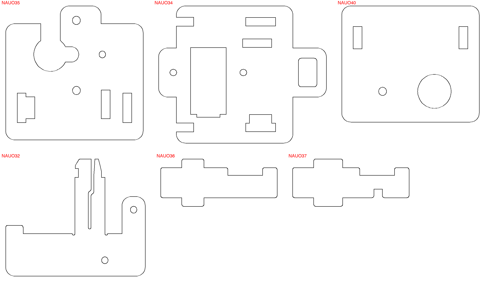
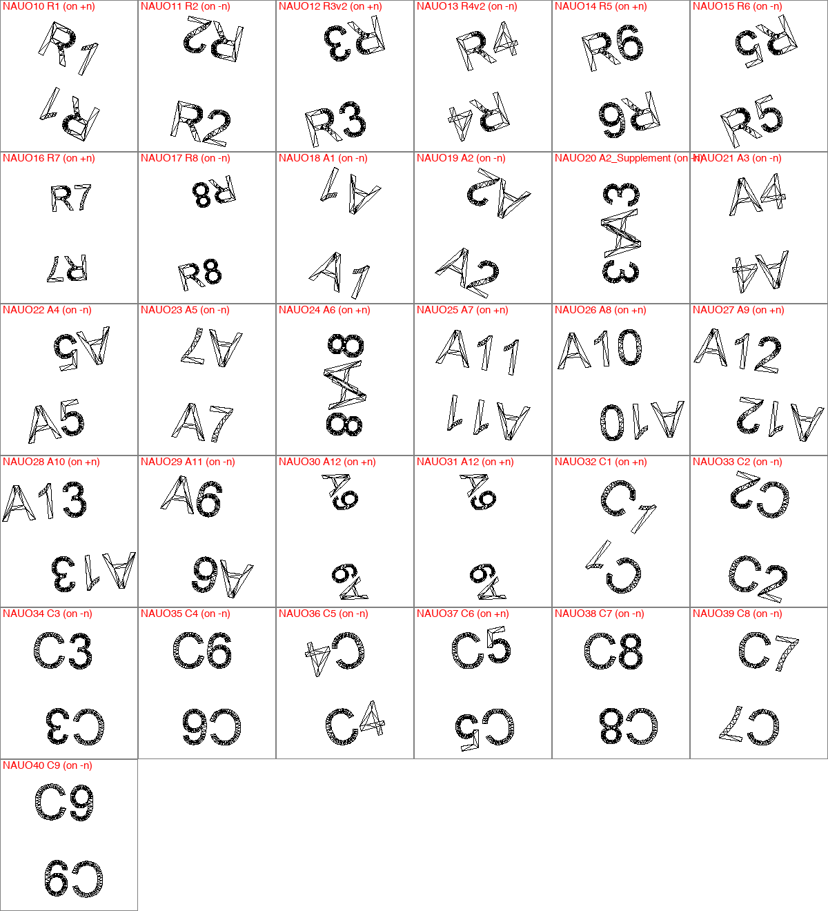

# MRA arm and claw: how they go together, from the CAD alone

Source: `MRA Build Instructions Prototype/mra.glb` (full-detail export), measured with trimesh on 13 Oct 2026. Data: `cad_arm_claw.json`. Figures: `cad_arm_claw_img/`.

**Names.** Every part name in this report is the CAD mesh name (`ARA_A5` is written "A5"), always with its instance id `NAUOn`. These are NOT the codes engraved on the wood: for 17 of the 25 arm and claw plates the text engraved in the CAD differs from the CAD name (table in section 9). Another report reads the engravings; use that one for what the guide should call a part.

**Axes.** mm, assembly space, Y up. The arm plates are all normal to Z. "-Z side" is the side of turret plate CAD R6 NAUO15 (servo NAUO58); "+Z side" is the side of CAD R5 NAUO14 (servo NAUO66). Directions used below: `arm` = [0.67, 0.74, 0] along the upper arm from shoulder to elbow; `armN` = [0.74, -0.67, 0] the normal of the cross plate A11; `fore` = [0.91, -0.41, 0] along the forearm from elbow to wrist; `n` = [0.011, 1, 0] the claw plate normal (the claw is turned 0.6 degrees about Z in the CAD). All of these are for the pose the CAD is drawn in.

## 1. What matters most

- Shoulder servos NAUO58 and NAUO66 go into the turret side plates **from outside, shaft first**. The ears stop on the outer face of the side plate; a small clamp plate (CAD R8 NAUO17 / R7 NAUO16) goes over the back of the servo and two M3x10 screws beside the servo pull it onto the ears. The lead has to be passed through the clamp plate first.
- Servo NAUO66 (+Z) turns the **upper arm** directly through a horn lying in a pocket in A6 NAUO24. Servo NAUO58 (-Z) turns a **three-layer lever** (A1 + A2 + A2_Supplement, NAUO18/19/20) through a horn lying in a pocket in A2 and A2_Supplement; the lever moves the forearm through link A3 NAUO21 and the short end of A4 NAUO22.
- The upper arm is an **H-frame**: A5 NAUO23 and A6 NAUO24 on the tabs of the cross plate A11 NAUO29, pulled together by two M3x16 screws that thread into the two T-shaped pieces "A12" (NAUO30, NAUO31). The T-pieces are wooden nuts, not spacers.
- The H-frame **straddles the ear of R2 NAUO11**: A5 on its -Z face, A6 well clear on the +Z side. The only fastener between the arm and R2 is the M3x6 pivot screw NAUO55, whose head sits inside a 5.7 mm hole in the lever plate A1.
- With the turret already complete the -Z side has a **forced order**: upper arm, screw NAUO55 (driver through the servo cut-out of R6), lever, servo NAUO58, clamp plate R8, its two screws. The lever only goes over the head of NAUO55 when it is swung 40 to 90 degrees up from the pose drawn in the CAD.
- Three parallelograms (lever/A3/A4/upper arm; A7/A8 with the turret; A9/A8/A10 with the claw) make the two servos independent and keep the claw level. All link lengths are 80.0, 35.0, 40.1 or 20.15 mm.
- Claw servo NAUO72 goes **up through C3 NAUO34 from below, lead first**; its ears end up under C3, propped by C5 NAUO36 and C6 NAUO37, with C4 NAUO35 below. Two M3x16 screws (NAUO74, 75) go up through C4 into C3; C9 NAUO40 then covers their heads, so they must go in first.
- C1 NAUO32 and C2 NAUO33 are **clip plates**: two sprung prongs each go down through C3, C4 and C9 and one 1.1 mm barb hooks under C9. They also carry the three holes the arm screws into (NAUO77, 78 into C1; NAUO79 into C2).
- No nuts anywhere and no horn screws are modelled: 2.3 mm holes are threads, 2.8 mm holes are clearance, 5.6 to 5.7 mm holes take a screw head.
- A full order with four hand-built sub-assemblies (upper arm, lever, triangle linkage, claw) is in section 7. Every step that is not a screw was tested with `stepgen.blocked` and is free.

## 2. Servos and horns

All four are the same MG90S mesh (one mesh per servo, split here into connected pieces). Measured on it: case 22.6 x 12.15 mm; mounting ears 32.2 mm tip to tip, 2.5 mm thick, 11.4 to 13.9 mm back from the shaft tip; gear housing 14.7 mm long ending 3.95 mm back from the tip; output shaft 4.87 mm diameter, 3.95 mm long, 5.4 mm off the middle of the case. The lead leaves the end face at the same end as the shaft, 27.5 mm back from the shaft tip (near the bottom of the case). Horns: hub 6.6 mm diameter and 4.55 mm long, arm 6.6 mm wide and 2.0 mm thick reaching 18.2 mm from the axis.

| servo | job | shaft tip | shaft points | lead leaves at | lead heads | flexible lead part |
|---|---|---|---|---|---|---|
| NAUO45 | base rotation | [163.64, 91.61, 140.84] | [0, -1, 0] | [163.64, 119.11, 146.69] | [0, 0, 1] | NAUO87 `Part1^ARA_Pathways` |
| NAUO58 | elbow (forearm) servo, on the -Z side of the turret | [175.66, 162.28, 120.35] | [0, 0, 1] | [181.51, 162.28, 92.85] | [1, 0, 0] | NAUO88 `Part2^ARA_Pathways` |
| NAUO66 | shoulder (upper arm) servo, on the +Z side of the turret | [175.66, 162.28, 160.85] | [0, 0, -1] | [181.51, 162.28, 188.35] | [1, 0, 0] | NAUO89 `Part3^ARA_Pathways` |
| NAUO72 | claw servo | [335.11, 179.37, 138.76] | [-0.01, -1, 0] | [335.4, 206.87, 132.91] | [0, 0, -1] | NAUO94 `Part5^ARA_Pathways` |

**Servo NAUO45: base rotation.** Drives the turret: the horn is held still in the base plates, so the servo and the whole turret turn on it. Held by R1 NAUO10 (the ears rest on its top face, y = 102.96; the case hangs through a 12.5 x 22.7 mm cut-out, x 157.4-169.9, z 124.1-146.8, with a 5.7 x 6.4 mm extension at the lead end and a 1.0 mm slit to the edge of R1) and R2 NAUO11 (a 12.5 mm wide notch open at its bottom edge, x 157.4-169.9, y 103.0-123.3, that straddles the case; 0.00 mm gap). Goes in shaft pointing down, through R1 from above; R2 then comes down over the case. Ears between [163.64, 102.98, 140.84] and [163.64, 105.48, 140.84]. Horn: NAUO46 (double-ended, 36.3 mm tip to tip, arms along +Z and -Z). The horn lies in a horn-shaped pocket cut through B2 NAUO2 (y 90.53-93.53) and dips 0.67 mm into a matching 37.5 x 8.0 mm hole in B1 NAUO1; no screw touches it; B2 is clamped to B1 by the six M3x6 screws NAUO47-52.

**Servo NAUO58: elbow (forearm) servo, on the -Z side of the turret.** Drives the three-layer lever A1 + A2 + A2_Supplement (NAUO18, 19, 20), which moves the forearm through link A3 NAUO21 and the rear end of A4 NAUO22. Held by R6 NAUO15 (case and gear housing pass through its 22.8 x 12.3 mm cut-out, which has a 1 x 8 mm notch at the +X end, centred [170.61, 162.28, 110.5]; the ears lie on its outer face z = 109.0) and R8 NAUO17 (clamp plate over the back of the case, 23.2 x 12.3 mm cut-out plus a 1 x 8 mm notch, lying on the outer face of the ears). Goes in from outside the turret, shaft first, moving +Z. Ears between [175.66, 162.28, 108.98] and [175.66, 162.28, 106.48]. Horn: NAUO59 (single arm, 18.2 mm from the shaft axis to its tip, pointing [0.91, -0.41, 0]). The horn lies in the horn-shaped pocket (22.7 x 8.0 mm) cut through A2_Supplement NAUO20 and A2 NAUO19; A1 NAUO18 closes the pocket on the inside; no screw touches the horn; the three lever plates are clamped by the M3x10 screw NAUO56.

**Servo NAUO66: shoulder (upper arm) servo, on the +Z side of the turret.** Drives the upper arm directly: A6 NAUO24, and with it A5, A11 and the two A12. Held by R5 NAUO14 (22.8 x 12.3 mm cut-out with a 1 x 8 mm notch at the +X end, centred [170.61, 162.28, 170.7]; ears on its outer face z = 172.2) and R7 NAUO16 (clamp plate over the back of the case, same cut-out as R8). Goes in from outside the turret, shaft first, moving -Z. Ears between [175.66, 162.28, 172.23] and [175.66, 162.28, 174.73]. Horn: NAUO67 (single arm, pointing [0.67, 0.74, 0], along the upper arm). The horn lies in the horn-shaped pocket (22.7 x 8.0 mm) of A6 NAUO24, with 0.15 mm clearance all round; the edge of the cross plate A11 NAUO29 is under the outer 8 mm of the horn arm (0.00 mm gap) and stops it falling inwards; no screw touches it.

**Servo NAUO72: claw servo.** Drives the jaw CAD ARA_C8 NAUO39; the other jaw CAD ARA_C7 NAUO38 is geared to it. Held by C3 NAUO34 (the case passes up through its 23.2 x 12.3 mm cut-out, notch at the -Z end, centred [335.27, 194.72, 143.81]; the ears lie under C3, on its engraved face), C5 NAUO36 and C6 NAUO37 (a shoulder of each sits 0.10 mm under an ear), and C4 NAUO35 about 0.6 mm below the top of the gear housing; one ear tip is 0.11 mm from C2 NAUO33. Goes in from below C3 (from its engraved face), lead and case first, moving +Y, until the ears stop under C3. Ears between [335.22, 190.7, 138.76] and [335.25, 193.25, 138.76]. Horn: NAUO73 (single arm, pointing forward [1, 0, -0.03]). The horn lies in the horn-shaped pocket (22.7 x 7.7 mm) of the jaw CAD ARA_C8 NAUO39, between C4 above and C9 below; no screw touches it; the 11.7 mm hole in C9 NAUO40 is on the shaft axis (driver access to the shaft end).

Which way each horn faces: the splined socket of every horn faces its servo and the recess for a horn screw faces away from it. For NAUO59 that recess faces A1 and the head of screw NAUO55; for NAUO67 it faces into the arm; for NAUO73 it faces down into the 11.7 mm hole of C9. No horn screw is in the CAD.

The clamp plates and the lead: R7 NAUO16, R8 NAUO17 and the cut-out of C3 all have a 1 x 8 mm notch in one end of the servo cut-out. On R7 and C3 the notch is at the end where the lead leaves; on R8 it is at the other end (see section 10).

## 3. Screws NAUO47 to NAUO79

All are socket-head M3 (head 5.5 mm diameter, 3.0 mm high); the mesh names give 6, 10 or 16 mm. "Passes" lists what surrounds the shank from the head end, with the hole diameter measured by ray casts: 2.3 = thread, 2.8 = clearance, 5.6 to 5.7 = the head sits in it. Clamp = the parts are pulled tight together. Pivot = a part with a 2.8 mm hole has to turn on it, so it is not to be done up hard.

| screw | size | head top | points (head to tip) | passes, from the head | clamp or pivot | what it does |
|---|---|---|---|---|---|---|
| NAUO47 | M3x6 | [209.2, 96.56, 99.64] | -Y | B2 NAUO2 (2.8 free) > B1 NAUO1 (2.3 thread) | clamp | B2 to B1 |
| NAUO48 | M3x6 | [104.11, 96.56, 99.64] | -Y | B2 NAUO2 (2.8 free) > B1 NAUO1 (2.3 thread) | clamp | B2 to B1 |
| NAUO49 | M3x6 | [-20.8, 96.56, 99.64] | -Y | B2 NAUO2 (2.8 free) > B1 NAUO1 (2.3 thread) | clamp | B2 to B1 |
| NAUO50 | M3x6 | [-20.8, 96.56, 181.94] | -Y | B2 NAUO2 (2.8 free) > B1 NAUO1 (2.3 thread) | clamp | B2 to B1 |
| NAUO51 | M3x6 | [104.11, 96.56, 181.94] | -Y | B2 NAUO2 (2.8 free) > B1 NAUO1 (2.3 thread) | clamp | B2 to B1 |
| NAUO52 | M3x6 | [209.2, 96.56, 181.94] | -Y | B2 NAUO2 (2.8 free) > B1 NAUO1 (2.3 thread) | clamp | B2 to B1 |
| NAUO53 | M3x16 | [200.72, 189.99, 123.54] | +Z | A5 NAUO23 (2.8 free) > A12 NAUO30 (2.3 thread) | clamp | A5 onto the cross plate A11, by threading into the lower T-piece A12 NAUO30 (the screw runs 7 mm along a 3.2 mm slot in A11 between the two) |
| NAUO54 | M3x16 | [208.73, 198.86, 165.45] | -Z | A6 NAUO24 (2.8 free) > A12 NAUO31 (2.3 thread) | clamp | A6 onto the cross plate A11, by threading into the upper T-piece A12 NAUO31 |
| NAUO55 | M3x6 | [175.35, 161.84, 123.52] | +Z | A1 NAUO18 (5.7 head) > A5 NAUO23 (2.8 free) > R2 NAUO11 (2.3 thread) | pivot | shoulder pivot on the -Z side: A5 turns on it against R2; its head sits in the 5.74 mm hole of A1, so the lever turns about the same screw |
| NAUO56 | M3x10 | [158.64, 169.43, 114.54] | +Z | A2_Supplement NAUO20 (2.8 free) > A2 NAUO19 (2.8 free) > A1 NAUO18 (2.3 thread) | clamp | the three lever plates A2_Supplement, A2, A1; its tip stands 1.0 mm proud of the inner face of A1 |
| NAUO57 | M3x6 | [196.99, 235.71, 120.52] | +Z | A4 NAUO22 (2.8 free) > A3 NAUO21 (2.3 thread) | pivot | A4 (rear end) on A3 |
| NAUO60 | M3x10 | [170.31, 171.58, 100.45] | +Z | R8 NAUO17 (2.8 free) > R6 NAUO15 (2.3 thread) | clamp | R8 to R6 with the servo ears between them (2.54 mm gap); passes 1.75 mm beside the servo case, not through the ear |
| NAUO61 | M3x10 | [170.31, 152.93, 100.45] | +Z | R8 NAUO17 (2.8 free) > R6 NAUO15 (2.3 thread) | clamp | R8 to R6, the other side of the servo |
| NAUO62 | M3x10 | [143.47, 176.3, 117.54] | +Z | A2_Supplement NAUO20 (5.6 head) > A2 NAUO19 (2.8 free) > A1 NAUO18 (2.8 free) > A3 NAUO21 (2.3 thread) | pivot | the lever on A3: head sunk in the 5.58 mm hole of A2_Supplement, free through A2 and A1, threads into A3 |
| NAUO63 | M3x6 | [228.88, 221.29, 120.52] | +Z | A4 NAUO22 (2.8 free) > A5 NAUO23 (2.3 thread) | pivot | elbow, -Z side: A4 turns on it; threads into A5 |
| NAUO64 | M3x6 | [193.07, 239.08, 172.23] | -Z | A7 NAUO25 (2.8 free) > A8 NAUO26 (2.3 thread) | pivot | A7 on the triangle A8 |
| NAUO65 | M3x6 | [239.08, 238.63, 172.23] | -Z | A9 NAUO27 (2.8 free) > A8 NAUO26 (2.3 thread) | pivot | A9 on the triangle A8 |
| NAUO68 | M3x10 | [170.27, 171.57, 180.75] | -Z | R7 NAUO16 (2.8 free) > R5 NAUO14 (2.3 thread) | clamp | R7 to R5 with the servo ears between them; passes beside the servo case |
| NAUO69 | M3x10 | [170.31, 152.98, 180.75] | -Z | R7 NAUO16 (2.8 free) > R5 NAUO14 (2.3 thread) | clamp | R7 to R5, the other side of the servo |
| NAUO70 | M3x6 | [139.38, 179.78, 175.23] | -Z | R5 NAUO14 (2.8 free) > A7 NAUO25 (2.3 thread) | pivot | A7 on the turret: head outside R5, free through R5, threads into A7, so the screw turns with A7 inside the hole of R5 |
| NAUO71 | M3x10 | [228.97, 221.31, 172.21] | -Z | A10 NAUO28 (2.8 free) > A8 NAUO26 (2.8 free) > A6 NAUO24 (2.3 thread) | pivot | elbow, +Z side: A10 and A8 turn on it; threads into A6 (0.76 mm air gap between A8 and A6) |
| NAUO74 | M3x16 | [322.93, 176.84, 147.11] | +Y | C4 NAUO35 (2.8 free) > C3 NAUO34 (2.3 thread) | clamp | C4 to C3, with C5, C6 and the servo ears trapped between; its 3.02 mm head fills the 3.00 mm jaw layer and C9 rests on it |
| NAUO75 | M3x16 | [347.24, 176.58, 147.03] | +Y | C4 NAUO35 (2.8 free) > C3 NAUO34 (2.3 thread) | clamp | C4 to C3, the other one |
| NAUO76 | M3x10 | [335.39, 170.7, 156.09] | +Y | C9 NAUO40 (2.8 free) > C7 NAUO38 (2.8 free) > C4 NAUO35 (2.3 thread) | pivot | the jaw CAD ARA_C7 NAUO38 turns on it between C9 and C4; it also holds C9 up; its tip ends in a notch of C6 |
| NAUO77 | M3x6 | [311.98, 205.67, 172.23] | -Z | A9 NAUO27 (2.8 free) > C1 NAUO32 (2.3 thread) | pivot | A9 on C1 (keeps the claw level) |
| NAUO78 | M3x6 | [301.81, 188.27, 172.23] | -Z | A10 NAUO28 (2.8 free) > C1 NAUO32 (2.3 thread) | pivot | A10 on C1 (wrist, +Z side) |
| NAUO79 | M3x6 | [301.86, 188.36, 120.52] | +Z | A4 NAUO22 (2.8 free) > C2 NAUO33 (2.3 thread) | pivot | A4 on C2 (wrist, -Z side) |

Driver access in the finished model (rays back from each head along its axis): NAUO55 is hidden behind horn NAUO59 and servo NAUO58; NAUO56 is behind R6, servo NAUO58 and R8; NAUO62 is partly behind the top edge of R6 in the CAD pose (5 of 12 rim rays); NAUO74 is fully and NAUO75 partly under C9. Every other head is open.

## 4. The arm

### 4.1 Layers along Z

| z from - to | at the shoulder | elsewhere |
|---|---|---|
| 88.1 - 116.4 | servo NAUO58 body (shaft to 120.35) |  |
| 103.46 - 106.46 | clamp plate R8 NAUO17 |  |
| 106.48 - 108.98 | servo NAUO58 ears |  |
| 109.0 - 112.0 | turret side R6 NAUO15 |  |
| 117.55 - 120.55 | A2_Supplement NAUO20 (lever) |  |
| 120.55 - 123.55 | A2 NAUO19 (lever) |  |
| 123.55 - 126.55 | A1 NAUO18 (lever), head of screw NAUO55 inside its hole | A4 NAUO22 |
| 126.55 - 129.55 | A5 NAUO23 | A3 NAUO21; at the wrist C2 NAUO33 |
| 129.55 - 132.55 | R2 NAUO11 (ear, top at y 167.9) |  |
| 129.6 - 159.4 |  | cross plate A11 NAUO29 (its tabs reach 126.4 and 162.6) |
| 159.44 - 162.44 | A6 NAUO24 with horn NAUO67 |  |
| 163.2 - 166.2 |  | A8 NAUO26; at the wrist C1 NAUO32 |
| 166.2 - 169.2 |  | A7 NAUO25, A9 NAUO27, A10 NAUO28 |
| 169.2 - 172.2 | turret side R5 NAUO14 |  |
| 172.23 - 174.73 | servo NAUO66 ears |  |
| 174.74 - 177.74 | clamp plate R7 NAUO16 |  |
| 164.8 - 193.1 | servo NAUO66 body (shaft to 160.85) |  |

The gap between R6 (inner face z 112.0) and R2 (z 129.55) is 17.55 mm; lever (9.0) plus A5 (3.0) fill 12.0 of it, and the servo gear housing fills 4.4 more on the R6 side. Between A8 and A6 there is a 0.76 mm air gap; everything else in the table touches its neighbour.

 

Both pictures are seen from +Z, so text engraved on -Z faces reads mirrored in the first one.

### 4.2 Contact graph (arm)

| part | part | how they meet | where | note |
|---|---|---|---|---|
| R5 NAUO14 | servo NAUO66 | through cut-out | [170.61, 162.28, 170.7] | servo case through R5; ears on the outer face z = 172.2 |
| R7 NAUO16 | servo NAUO66 | through cut-out | [170.61, 162.28, 176.24] | R7 over the back of the case, against the ears |
| R6 NAUO15 | servo NAUO58 | through cut-out | [170.61, 162.28, 110.5] | servo case through R6; ears on the outer face z = 109.0 |
| R8 NAUO17 | servo NAUO58 | through cut-out | [169.95, 162.28, 104.96] | R8 over the back of the case, against the ears |
| R2 NAUO11 | A5 NAUO23 | face to face | [175.33, 161.9, 129.55] | A5 against the -Z face of the ear of R2, round the shoulder pivot |
| R5 NAUO14 | A7 NAUO25 | face to face | [139.41, 179.84, 169.2] | A7 against the inner face of R5, round its ground pivot |
| A1 NAUO18 | A2 NAUO19 | face to face | [165.9, 166.2, 123.55] | whole face, same outline |
| A2 NAUO19 | A2_Supplement NAUO20 | face to face | [165.9, 166.2, 120.55] | whole face, same outline |
| A2 NAUO19 | horn NAUO59 | horn in pocket | [181.19, 159.26, 122.05] | CAD overlap up to 0.19 mm |
| A2_Supplement NAUO20 | horn NAUO59 | horn in pocket | [181.19, 159.26, 119.05] | CAD overlap up to 0.20 mm |
| servo NAUO58 | horn NAUO59 | spline on shaft | [175.66, 162.28, 118.9] | horn hub over the output shaft, 2.8 mm engaged |
| A1 NAUO18 | A5 NAUO23 | face to face | [175.33, 161.9, 126.55] | A1 against the outer face of A5 round the shoulder pivot |
| A1 NAUO18 | A3 NAUO21 | face to face | [143.44, 176.32, 126.55] | A3 against the inner face of A1 round the lever pivot |
| A3 NAUO21 | A4 NAUO22 | face to face | [197.05, 235.7, 126.55] | A4 against the outer face of A3 |
| A4 NAUO22 | A5 NAUO23 | face to face | [228.94, 221.29, 126.55] | A4 against the outer face of A5 at the elbow |
| A4 NAUO22 | C2 NAUO33 | face to face | [301.88, 188.31, 126.55] | A4 against the outer face of C2 at the wrist |
| A5 NAUO23 | A11 NAUO29 | tab in slot (x2) | [195.39, 184.12, 128.05] and [214.15, 204.9, 128.05] | two 10 x 3 mm tabs of A11 through A5 |
| A6 NAUO24 | A11 NAUO29 | tab in slot (x2) | [195.39, 184.12, 160.94] and [214.02, 204.75, 160.94] | two 10 x 3 mm tabs of A11 through A6 |
| A11 NAUO29 | A12 NAUO30 | T-piece through cross-slot | [200.72, 190.02, 138.01] | stem (7.2 x 5.3 mm) through A11, bar (25 x 6.4 mm) against the engraved face of A11 |
| A11 NAUO29 | A12 NAUO31 | T-piece through cross-slot | [208.72, 198.89, 150.98] | as above, upper one |
| A6 NAUO24 | horn NAUO67 | horn in pocket | [179.64, 166.68, 160.94] | 0.15 mm clearance |
| A11 NAUO29 | horn NAUO67 | edge under horn | [185, 172.6, 159.4] | the top edge of A11 backs the horn arm |
| servo NAUO66 | horn NAUO67 | spline on shaft | [175.66, 162.28, 162.3] | horn hub over the output shaft, 2.8 mm engaged |
| A7 NAUO25 | A8 NAUO26 | face to face | [193.11, 239.13, 166.2] | A7 against the outer (engraved) face of A8 |
| A8 NAUO26 | A9 NAUO27 | face to face | [239.11, 238.69, 166.2] | A9 against the outer face of A8 |
| A8 NAUO26 | A10 NAUO28 | face to face | [228.94, 221.29, 166.2] | A10 against the outer face of A8 at the elbow |
| A9 NAUO27 | C1 NAUO32 | face to face | [312.01, 205.73, 166.2] | A9 against the outer face of C1 |
| A10 NAUO28 | C1 NAUO32 | face to face | [301.84, 188.33, 166.2] | A10 against the outer face of C1 at the wrist |

Screws are left out of this table; section 3 says what each passes through. Three rows (A4 on C2, A9 on C1, A10 on C1) are where the arm meets the claw.

### 4.3 The upper arm joint in detail

Seen square on to A11 (horizontal = along the arm, vertical = Z). A11 has a cross-shaped slot open to its A5 edge and another open to its A6 edge, 12 mm further along. Each is a 3.2 mm wide slot 14.3 mm deep for the screw, crossed by a 7.2 x 3.2 mm window. A T-piece is pushed stem first through the window from the engraved face of A11 (motion [0.74, -0.67, 0]); its bar stops against that face and the 2.3 mm hole in the stem ends up in the middle of the thickness of A11. The M3x16 screw comes through A5 (or A6), runs 7 mm along the slot and threads through the stem. Tested: with A11 alone each T-piece is free only back the way it came.

### 4.4 Rigid groups and pivots

| group | parts | note |
|---|---|---|
| turret (fixed frame for the arm) | R1 NAUO10, R2 NAUO11, R3v2 NAUO12, R4v2 NAUO13, R5 NAUO14, R6 NAUO15, R7 NAUO16, R8 NAUO17, servo NAUO58, servo NAUO66, screw NAUO55, screw NAUO60, screw NAUO61, screw NAUO68, screw NAUO69 | R1-R6, the two clamp plates, the two servo bodies, their four screws, and the shoulder pivot screw NAUO55 (threaded into R2) |
| upper arm | A5 NAUO23, A6 NAUO24, A11 NAUO29, A12 NAUO30, A12 NAUO31, screw NAUO53, screw NAUO54, screw NAUO63, screw NAUO71, horn NAUO67 | A5 + A6 + A11 + two A12 + two M3x16; the horn of servo NAUO66; the two elbow screws thread into it |
| lever (elbow crank) | A1 NAUO18, A2 NAUO19, A2_Supplement NAUO20, screw NAUO56, horn NAUO59 | A1 + A2 + A2_Supplement + M3x10; the horn of servo NAUO58 |
| link A3 | A3 NAUO21, screw NAUO62, screw NAUO57 | both of its pivot screws thread into it |
| forearm, -Z side (A4) | A4 NAUO22 | three clearance holes in a line: rear (to A3), elbow, wrist |
| rear link A7 | A7 NAUO25, screw NAUO70 | its ground pivot screw threads into it |
| triangle A8 | A8 NAUO26, screw NAUO64, screw NAUO65 | turns on the elbow screw NAUO71; stays at a fixed attitude |
| levelling link A9 | A9 NAUO27 |  |
| forearm, +Z side (A10) | A10 NAUO28 |  |

| pivot | between | axis | through (x, y) | made by | note |
|---|---|---|---|---|---|
| shoulder | turret (fixed frame for the arm) and upper arm | along Z | [175.66, 162.28] | NAUO66 + NAUO67, NAUO55 | servo NAUO66 shaft on the +Z side; screw NAUO55 on the -Z side at [175.33, 161.90] (0.50 mm from the shaft axis in the CAD) |
| lever on the shoulder axis | turret (fixed frame for the arm) and lever (elbow crank) | along Z | [175.66, 162.28] | NAUO58 + NAUO59, head of NAUO55 | servo NAUO58 shaft; the 5.74 mm hole of A1 also rides on the 5.5 mm head of screw NAUO55 |
| lever to A3 | lever (elbow crank) and link A3 | along Z | [143.44, 176.32] | NAUO62 | 35.0 mm from the shoulder |
| A3 to A4 | link A3 and forearm, -Z side (A4) | along Z | [197.05, 235.70] | NAUO57 | 80.0 mm along A3 |
| elbow | upper arm and forearm, -Z side (A4) | along Z | [228.94, 221.29] | NAUO63 | 80.0 mm from the shoulder; 35.0 mm from the A3 hole of A4 |
| elbow | upper arm and forearm, +Z side (A10) | along Z | [228.94, 221.29] | NAUO71 | same axis, +Z side |
| elbow | upper arm and triangle A8 | along Z | [228.94, 221.29] | NAUO71 | the triangle turns on the same screw, between A10 and A6 |
| A7 ground pivot | turret (fixed frame for the arm) and rear link A7 | along Z | [139.41, 179.84] | NAUO70 | in the lobe of R5; 40.15 mm from the shoulder |
| A7 to A8 | rear link A7 and triangle A8 | along Z | [193.11, 239.13] | NAUO64 | 80.0 mm along A7; 40.03 mm from the elbow |
| A8 to A9 | triangle A8 and levelling link A9 | along Z | [239.11, 238.69] | NAUO65 | 20.15 mm from the elbow |
| wrist | forearm, -Z side (A4) and claw body | along Z | [301.88, 188.31] | NAUO79 | 80.05 mm from the elbow |
| wrist | forearm, +Z side (A10) and claw body | along Z | [301.84, 188.33] | NAUO78 | 80.0 mm from the elbow |
| A9 to claw | levelling link A9 and claw body | along Z | [312.01, 205.73] | NAUO77 | 80.0 mm along A9; 20.15 mm from the wrist |

Geometry of the linkage (side view): shoulder S [175.33, 161.90], elbow E [228.94, 221.29], wrist W [301.88, 188.31]. S-E 80.0. Lever S-P 35.0 to P [143.44, 176.32]; A3 P-Q 80.0 to Q [197.05, 235.70]; A4 Q-E 35.0 and E-W 80.05 in one straight line. So S-P-Q-E is a parallelogram and the forearm always points opposite to the lever: servo NAUO58 alone sets the forearm angle. A7 runs G [139.41, 179.84] to H [193.11, 239.13], 80.0; S-G is 40.15 and E-H is 40.03, so S-G-H-E is a parallelogram and the triangle A8 keeps a fixed attitude. A9 runs K [239.11, 238.69] to J [312.01, 205.73], 80.0; E-K and W-J are both 20.15, so E-K-J-W is a parallelogram and the claw body stays parallel to A8, i.e. level. In the CAD pose the upper arm is at 47.9 degrees above +X and the forearm at 24.3 degrees below it.

## 5. The claw

### 5.1 Layers along the claw normal (bottom to top, y at x = 335)

| y from - to | what |
|---|---|
| 173.6 - 176.6 | C9 NAUO40 (bottom cover); the head of the pivot screw NAUO76 is below it |
| 176.6 - 179.6 | the two jaws NAUO38, NAUO39; heads of screws NAUO74, 75; horn arm NAUO73 (in the jaw pocket) |
| 179.6 - 182.6 | C4 NAUO35 (keyhole plate); horn hub and shaft stand in the keyhole |
| 182.6 - 193.1 | servo gear housing and case top; spacer bars C5 NAUO36 (z 131) and C6 NAUO37 (z 157) span this gap |
| 190.7 - 193.2 | servo ears, on the shoulders of C5 and C6 |
| 193.1 - 196.1 | C3 NAUO34 (servo plate) |
| 196.1 - 211.0 | bodies of the clips C1 NAUO32 (z 164.7) and C2 NAUO33 (z 128.05); the servo case stands up to y 211.7; the lead leaves at y 206.9 towards -Z |

### 5.2 Contact graph (claw)

| part | part | how they meet | where | note |
|---|---|---|---|---|
| C3 NAUO34 | servo NAUO72 | through cut-out | [335.27, 194.72, 143.81] | servo case through C3; ears under C3 |
| C5 NAUO36 | servo NAUO72 | shoulder under ear | [335.2, 191.7, 131] | 0.10 mm gap |
| C6 NAUO37 | servo NAUO72 | shoulder under ear | [335.2, 191.8, 157.2] | 0.10 mm gap |
| C2 NAUO33 | servo NAUO72 | near | [341, 193.2, 128.7] | ear tip 0.11 mm from C2 |
| C3 NAUO34 | C5 NAUO36 | tab in slot | [315, 194.9, 131.05] | upper tab of C5 (7.6 mm wide) in the inner half of the 6 mm wide double slot of C3; the top edge of C5 also touches C3 at [343.8, 193.1, 131.2] |
| C3 NAUO34 | C6 NAUO37 | tab in slot | [318.29, 194.9, 157.22] | upper tab of C6 (10 mm wide) in the 10 x 3 slot of C3 |
| C4 NAUO35 | C5 NAUO36 | tab in slot | [315, 181.4, 131.05] | lower tab of C5 in the inner half of the double slot of C4 |
| C4 NAUO35 | C6 NAUO37 | tab in slot | [318.15, 181.4, 157.22] | lower tab of C6 in the 10 x 3 slot of C4 |
| C1 NAUO32 | C3 NAUO34 | clip through slot + tooth | [317.12, 194.92, 164.7] | both prongs of C1 through the 10.3 x 3 slot; C1 sits on the top face of C3; a tooth at the front drops into the edge notch of C3 at x 338-344 |
| C1 NAUO32 | C4 NAUO35 | clip through slot | [316.97, 181.41, 164.7] | prongs through the 10.3 x 3 slot of C4 |
| C1 NAUO32 | C9 NAUO40 | clip through slot, barb under | [316.8, 175.41, 164.7] | prongs squeezed through the 7.8 x 3 slot of C9; shoulders on top of C9, one 1.1 mm barb underneath |
| C2 NAUO33 | C3 NAUO34 | clip through slot + tooth | [317.12, 194.92, 128.05] | prongs of C2 through the outer half of the double slot of C3 |
| C2 NAUO33 | C4 NAUO35 | clip through slot | [316.97, 181.41, 128.05] | prongs through the outer half of the double slot of C4 |
| C2 NAUO33 | C9 NAUO40 | clip through slot, barb under | [316.8, 175.41, 128.05] | as C1 |
| C2 NAUO33 | C5 NAUO36 | face to face | [317, 188.2, 129.55] | the prongs of C2 lie against the outer face of C5 |
| C4 NAUO35 | C7 NAUO38 | face to face | [338.8, 179.6, 156] | jaw against the underside of C4 |
| C4 NAUO35 | C8 NAUO39 | face to face | [335.5, 179.7, 136.9] | jaw against the underside of C4 |
| C7 NAUO38 | C9 NAUO40 | face to face | [335.7, 176.7, 156.1] | jaw on top of C9 |
| C8 NAUO39 | C9 NAUO40 | face to face | [335.4, 176.7, 138] | jaw on top of C9 |
| C7 NAUO38 | C8 NAUO39 | gear teeth | [335.7, 178.2, 147.7] | the two jaws mesh half-way between their axes (17.3 mm apart) |
| C8 NAUO39 | horn NAUO73 | horn in pocket | [342.02, 178.14, 137.91] | CAD overlap up to 0.35 mm (a press fit as drawn) |
| C4 NAUO35 | horn NAUO73 | hub through keyhole | [335.13, 181.2, 138.76] | the horn hub and shaft stand in the keyhole notch of C4, which is open to the front edge |
| servo NAUO72 | horn NAUO73 | spline on shaft | [335.2, 180.8, 138.8] | horn hub over the output shaft |

### 5.3 The clips C1 and C2

Measured on the outline of C1 (C2 is the same), along the claw normal t (C9 is t 177.31 to 180.31, C4 183.31 to 186.31, C3 196.81 to 199.81): the plate body sits on top of C3 from t 199.8. Two prongs hang down, together 10.32 mm wide with a 1.0 mm slit between them that runs from the tips up to about t 186. They pass freely through the 10.32 mm slots of C3 and C4. At t 180.3 both step in by 1.19 mm (shoulders that sit on the top face of C9) to 7.94 mm over both, in the 7.81 mm slot of C9. Below C9 the longer prong steps back out 1.08 mm (the barb, at t 176.3 to 177.3) and then tapers to the tip at t 174.0. So each clip snaps under C9 with one barb; the other prong has none. The collision test passes them as a press fit (the barb is under its 1.2 mm allowance).

### 5.4 Rigid groups and pivots

- **claw body**: C1 NAUO32, C2 NAUO33, C3 NAUO34, C4 NAUO35, C5 NAUO36, C6 NAUO37, C9 NAUO40, servo NAUO72, screw NAUO74, screw NAUO75, screw NAUO76, screw NAUO77, screw NAUO78, screw NAUO79. C1-C6 and C9 (CAD names), servo NAUO72, and the six screws that thread into it
- **driven jaw**: C8 NAUO39, horn NAUO73. jaw CAD ARA_C8 with the horn
- **geared jaw**: C7 NAUO38. jaw CAD ARA_C7
- Driven jaw axis: the servo shaft, through [335.13, y, 138.76] along [0.011, 1, 0]. Geared jaw axis: screw NAUO76, through [335.45, y, 156.07]. The axes are 17.3 mm apart and the gear sectors are equal, so the jaws turn equal and opposite.

## 6. Directions each part can be slid out along

Tested with `stepgen.blocked` against every part that touches it in the finished model (screws left out; servos as case + shaft). A part that is boxed in here was not put in last; section 7 gives the direction at the moment it goes in. Direction names as at the top of this report; `long` / `short` are the part's own length and width.

| part | touches | free in the finished model | pinned by |
|---|---|---|---|
| R7 NAUO16 | servo NAUO66 | none | NAUO68, NAUO69 |
| R8 NAUO17 | servo NAUO58 | none | NAUO60, NAUO61 |
| A1 NAUO18 | A2 NAUO19, A3 NAUO21, A5 NAUO23 | +X, -X, +Y, -Y, +long, -long, +short, -short, +arm, -arm, +armN, -armN | NAUO55, NAUO56, NAUO62 |
| A2 NAUO19 | A1 NAUO18, A2_Supplement NAUO20, horn NAUO59 | none | NAUO56, NAUO62 |
| A2_Supplement NAUO20 | A2 NAUO19, horn NAUO59 | -Z | NAUO56, NAUO62 |
| A3 NAUO21 | A1 NAUO18, A4 NAUO22 | +X, -X, +Y, -Y, +Z, +long, -long, +short, -short, +arm, -arm, +armN, -armN | NAUO57, NAUO62 |
| A4 NAUO22 | A3 NAUO21, A5 NAUO23, C2 NAUO33 | +X, -X, +Y, -Y, -Z, +long, -long, +short, -short, +arm, -arm, +armN, -armN | NAUO57, NAUO63, NAUO79 |
| A5 NAUO23 | R2 NAUO11, A1 NAUO18, A4 NAUO22, A11 NAUO29 | none | NAUO53, NAUO55, NAUO63 |
| A6 NAUO24 | A11 NAUO29, horn NAUO67 | +Z | NAUO54, NAUO71 |
| A7 NAUO25 | R5 NAUO14, A8 NAUO26 | +X, -X, +Y, -Y, +long, -long, +short, -short, +arm, -arm, +armN, -armN | NAUO64, NAUO70 |
| A8 NAUO26 | A7 NAUO25, A9 NAUO27, A10 NAUO28 | +X, -X, +Y, -Y, -Z, +arm, -arm, +armN, -armN | NAUO64, NAUO65, NAUO71 |
| A9 NAUO27 | A8 NAUO26, C1 NAUO32 | +X, -X, +Y, -Y, +Z, +long, -long, +short, -short, +arm, -arm, +armN, -armN | NAUO65, NAUO77 |
| A10 NAUO28 | A8 NAUO26, C1 NAUO32 | +X, -X, +Y, -Y, +Z, +long, -long, +short, -short, +arm, -arm, +armN, -armN | NAUO71, NAUO78 |
| A11 NAUO29 | A5 NAUO23, A6 NAUO24, A12 NAUO30, A12 NAUO31, horn NAUO67 | none | NAUO53, NAUO54 |
| A12 NAUO30 | A11 NAUO29 | -short, -armN | NAUO53 |
| A12 NAUO31 | A11 NAUO29 | -short, -armN | NAUO54 |
| C1 NAUO32 | A9 NAUO27, A10 NAUO28, C3 NAUO34, C4 NAUO35, C9 NAUO40 | none | NAUO77, NAUO78 |
| C2 NAUO33 | A4 NAUO22, C3 NAUO34, C4 NAUO35, C5 NAUO36, C9 NAUO40, servo NAUO72 | none | NAUO79 |
| C3 NAUO34 | C1 NAUO32, C2 NAUO33, C5 NAUO36, C6 NAUO37, servo NAUO72 | none | NAUO74, NAUO75 |
| C4 NAUO35 | C1 NAUO32, C2 NAUO33, C5 NAUO36, C6 NAUO37, C7 NAUO38, C8 NAUO39, horn NAUO73 | none | NAUO74, NAUO75, NAUO76 |
| C5 NAUO36 | C2 NAUO33, C3 NAUO34, C4 NAUO35, servo NAUO72 | none | - |
| C6 NAUO37 | C3 NAUO34, C4 NAUO35, servo NAUO72 | none | NAUO76 |
| C7 NAUO38 | C4 NAUO35, C8 NAUO39, C9 NAUO40 | +Z | NAUO76 |
| C8 NAUO39 | C4 NAUO35, C7 NAUO38, C9 NAUO40, horn NAUO73 | none | - |
| C9 NAUO40 | C1 NAUO32, C2 NAUO33, C7 NAUO38, C8 NAUO39 | -Y | NAUO74, NAUO75, NAUO76 |
| servo NAUO58 | R6 NAUO15, R8 NAUO17, horn NAUO59 | none | - |
| horn NAUO59 | A2 NAUO19, A2_Supplement NAUO20, servo NAUO58 | none | - |
| servo NAUO66 | R5 NAUO14, R7 NAUO16, horn NAUO67 | none | - |
| horn NAUO67 | A6 NAUO24, A11 NAUO29, servo NAUO66 | none | - |
| servo NAUO72 | C2 NAUO33, C3 NAUO34, C5 NAUO36, C6 NAUO37, horn NAUO73 | none | - |
| horn NAUO73 | C4 NAUO35, C8 NAUO39, servo NAUO72 | none | - |

Three results in this table are caused by CAD overlaps rather than by real obstruction: the horns NAUO59 and NAUO73 overlap their pockets (so A2, A2_Supplement, the horn and the jaw NAUO39 read as locked), and the servos read as locked by their horns because the shaft is inside the hub.

## 7. A geometric assembly order

Starting point: the turret is complete (CAD R1 to R6, NAUO10 to NAUO15, with the base servo). Each step lists what moves, onto what, the direction it travels, and what must already be there. "free" means `stepgen.blocked` found nothing in the way when the part is pulled back out along the same line past everything already present (servo = case + shaft). Screw steps are not tested that way (the thread overlaps the wood in the CAD by 0.35 mm); for them the driver path was checked instead.

The order in short:

- **A, in the hand: upper arm.** T-piece NAUO30 and T-piece NAUO31 into A11 NAUO29; A11 onto A5 NAUO23; screw NAUO53; A6 NAUO24; screw NAUO54; horn NAUO67 into A6.
- **B, in the hand: lever.** A2 NAUO19 onto A1 NAUO18; A2_Supplement NAUO20; screw NAUO56; horn NAUO59; A3 NAUO21; screw NAUO62.
- **C, in the hand: triangle linkage.** A7 NAUO25 onto A8 NAUO26, screw NAUO64; A9 NAUO27 onto A8, screw NAUO65.
- **M, on the turret.** upper arm over the ear of R2; screw NAUO55; lever (swung up, in, across, down); servo NAUO58; R8 NAUO17; screws NAUO60, NAUO61; servo NAUO66; R7 NAUO16; screws NAUO68, NAUO69; A4 NAUO22; screws NAUO57, NAUO63; triangle linkage; A10 NAUO28; screw NAUO71; screw NAUO70.
- **K, in the hand: claw.** servo NAUO72 up into C3 NAUO34; C5 NAUO36; C6 NAUO37; C4 NAUO35; screws NAUO74, NAUO75; horn NAUO73; jaw NAUO39; jaw NAUO38; C9 NAUO40; screw NAUO76; C2 NAUO33; C1 NAUO32.
- **W, claw onto the arm.** claw into the fork of A4 and A9 / A10; screws NAUO79, NAUO78, NAUO77.

### 7.1 Sub-assembly A: upper arm (in the hand)

| step | what moves | onto | travels | must already be there | check |
|---|---|---|---|---|---|
| A1 | NAUO30: T-piece (CAD A12, lower one) into A11: stem through the lower cross-slot, bar against the engraved face of A11 | NAUO29 | +armN [0.74, -0.67, 0] | NAUO29 | free |
| A2 | NAUO31: second T-piece (CAD A12) into the upper cross-slot of A11, same way | NAUO29 | +armN [0.74, -0.67, 0] | NAUO29, NAUO30 | free |
| A3 | NAUO29, NAUO30, NAUO31: A11 with its two T-pieces onto A5: two tabs into the two slots | NAUO23 | -Z [0, 0, -1] | NAUO23 | free |
| A4 | NAUO53: M3x16 screw from the outer face of A5, along the slot in A11, into the lower T-piece | NAUO23, NAUO30 | +Z [0, 0, 1] | NAUO23, NAUO29, NAUO30, NAUO31 | driver path clear |
| A5 | NAUO24: A6 onto the two upper tabs of A11 | NAUO29 | -Z [0, 0, -1] | NAUO23, NAUO29, NAUO30, NAUO31, NAUO53 | free |
| A6 | NAUO54: M3x16 screw from the outer face of A6 into the upper T-piece | NAUO24, NAUO31 | -Z [0, 0, -1] | NAUO23, NAUO24, NAUO29, NAUO30, NAUO31, NAUO53 | driver path clear |
| A7 | NAUO67: horn into the pocket of A6 from the outer face (splined socket facing out); it comes to rest on the edge of A11 | NAUO24 | -Z [0, 0, -1] | NAUO23, NAUO24, NAUO29, NAUO30, NAUO31, NAUO53, NAUO54 | free |

### 7.2 Sub-assembly B: lever and link A3 (in the hand)

| step | what moves | onto | travels | must already be there | check |
|---|---|---|---|---|---|
| B1 | NAUO19: A2 onto A1, face to face (edge notches together) | NAUO18 | +Z [0, 0, 1] | NAUO18 | free |
| B2 | NAUO20: A2_Supplement onto A2 | NAUO19 | +Z [0, 0, 1] | NAUO18, NAUO19 | free |
| B3 | NAUO56: M3x10 screw through A2_Supplement and A2 into A1 (middle hole) | NAUO20, NAUO19, NAUO18 | +Z [0, 0, 1] | NAUO18, NAUO19, NAUO20 | driver path clear |
| B4 | NAUO59: horn into the pocket of A2_Supplement / A2 (splined socket facing out) (the CAD horn overlaps the pocket wall by up to 0.2 mm, so this was tested with 0.5 mm tolerance) | NAUO20, NAUO19 | +Z [0, 0, 1] | NAUO18, NAUO19, NAUO20, NAUO56 | free |
| B5 | NAUO21: A3 against the free face of A1 at the end hole | NAUO18 | -Z [0, 0, -1] | NAUO18, NAUO19, NAUO20, NAUO56, NAUO59 | free |
| B6 | NAUO62: M3x10 screw: head into the 5.6 mm recess of A2_Supplement, through A2 and A1, into A3 (pivot) | NAUO20, NAUO19, NAUO18, NAUO21 | +Z [0, 0, 1] | NAUO18, NAUO19, NAUO20, NAUO56, NAUO59, NAUO21 | driver path clear |

### 7.3 Sub-assembly C: triangle linkage (in the hand)

| step | what moves | onto | travels | must already be there | check |
|---|---|---|---|---|---|
| C1 | NAUO25: A7 onto the engraved face of A8 (corner hole) | NAUO26 | -Z [0, 0, -1] | NAUO26 | free |
| C2 | NAUO64: M3x6 screw through A7 into A8 (pivot) | NAUO25, NAUO26 | -Z [0, 0, -1] | NAUO26, NAUO25 | driver path clear |
| C3 | NAUO27: A9 onto the engraved face of A8 (triangle marks together) | NAUO26 | -Z [0, 0, -1] | NAUO26, NAUO25, NAUO64 | free |
| C4 | NAUO65: M3x6 screw through A9 into A8 (pivot) | NAUO27, NAUO26 | -Z [0, 0, -1] | NAUO26, NAUO25, NAUO64, NAUO27 | driver path clear |

### 7.4 Mounting on the turret

| step | what moves | onto | travels | must already be there | check |
|---|---|---|---|---|---|
| M1 | NAUO23, NAUO24, NAUO29, NAUO30, NAUO31, NAUO53, NAUO54, NAUO67: upper arm lowered onto the turret so the ear of R2 goes between A5 and A6 | NAUO11 | -Y [0, -1, 0] | turret | free |
| M2 | NAUO55: M3x6 screw through A5 into R2; the driver reaches it through the servo cut-out of R6 (pivot) | NAUO23, NAUO11 | +Z [0, 0, 1] | turret + NAUO23, NAUO24, NAUO29, NAUO30, NAUO31, NAUO53, NAUO54, NAUO67 | driver path clear |
| M3a | NAUO18, NAUO19, NAUO20, NAUO56, NAUO59, NAUO21, NAUO62: lever (A3 hanging from it, pointing up) swung so its long end points up, lowered between R6 and A5, 3 mm short of A5 (tested with the lever turned 66 degrees up from the CAD pose, A3 turned to point straight up, all 3.2 mm to -Z) | NAUO23 | -Y [0, -1, 0] | turret + NAUO23, NAUO24, NAUO29, NAUO30, NAUO31, NAUO53, NAUO54, NAUO67, NAUO55 | free |
| M3b | NAUO18, NAUO19, NAUO20, NAUO56, NAUO59, NAUO21, NAUO62: lever pushed 3 mm sideways so the 5.7 mm hole of A1 goes over the head of screw NAUO55, then swung back down (works with the lever turned 40 to 90 degrees up from the CAD pose; in the CAD pose it is 0.45 mm short of room (the head of screw NAUO56 meets R6 after 2.55 mm)) | NAUO55, NAUO23 | +Z [0, 0, 1] | turret + NAUO23, NAUO24, NAUO29, NAUO30, NAUO31, NAUO53, NAUO54, NAUO67, NAUO55 | free |
| M4 | NAUO58: servo through the cut-out of R6 from outside, shaft into the horn in the lever | NAUO15, NAUO59 | +Z [0, 0, 1] | turret and everything fitted so far | free |
| M5 | NAUO17: R8 over the back of the servo (lead threaded through first), onto the servo ears | NAUO58 | +Z [0, 0, 1] | turret and everything fitted so far | free |
| M6 | NAUO60, NAUO61: two M3x10 screws through R8 into R6, either side of the servo | NAUO17, NAUO15 | +Z [0, 0, 1] | turret and everything fitted so far | driver path clear |
| M7 | NAUO66: servo through the cut-out of R5 from outside, shaft into the horn in A6 | NAUO14, NAUO67 | -Z [0, 0, -1] | turret and everything fitted so far | free |
| M8 | NAUO16: R7 over the back of the servo, onto the ears | NAUO66 | -Z [0, 0, -1] | turret and everything fitted so far | free |
| M9 | NAUO68, NAUO69: two M3x10 screws through R7 into R5 | NAUO16, NAUO14 | -Z [0, 0, -1] | turret and everything fitted so far | driver path clear |
| M10 | NAUO22: A4 against the engraved faces of A3 (rear hole) and A5 (middle hole) | NAUO21, NAUO23 | +Z [0, 0, 1] | turret and everything fitted so far | free |
| M11 | NAUO57: M3x6 screw through A4 into A3 (pivot) | NAUO22, NAUO21 | +Z [0, 0, 1] | turret and everything fitted so far | driver path clear |
| M12 | NAUO63: M3x6 screw through A4 into A5 (elbow pivot, -Z side) | NAUO22, NAUO23 | +Z [0, 0, 1] | turret and everything fitted so far | driver path clear |
| M13 | NAUO25, NAUO26, NAUO27, NAUO64, NAUO65: triangle linkage lowered in: A8 against the outer face of A6 at the elbow, the free end of A7 behind R5 | NAUO24, NAUO14 | -Y [0, -1, 0] | turret and everything fitted so far | free |
| M14 | NAUO28: A10 onto A8 at the elbow (square-mark end) | NAUO26 | -Z [0, 0, -1] | turret and everything fitted so far | free |
| M15 | NAUO71: M3x10 screw through A10 and A8 into A6 (elbow pivot, +Z side) | NAUO28, NAUO26, NAUO24 | -Z [0, 0, -1] | turret and everything fitted so far | driver path clear |
| M16 | NAUO70: M3x6 screw from outside through R5 into A7 (pivot) | NAUO14, NAUO25 | -Z [0, 0, -1] | turret and everything fitted so far | driver path clear |

### 7.5 Sub-assembly K: claw (in the hand)

| step | what moves | onto | travels | must already be there | check |
|---|---|---|---|---|---|
| K1 | NAUO72: servo up through the cut-out of C3 from its engraved face, lead first, until the ears meet C3 | NAUO34 | +n [0.01, 1, 0] | NAUO34 | free |
| K2 | NAUO36: C5 (CAD name): upper tab into C3, shoulder under one servo ear | NAUO34 | +n [0.01, 1, 0] | NAUO34, NAUO72 | free |
| K3 | NAUO37: C6 (CAD name): upper tab into C3, shoulder under the other ear | NAUO34 | +n [0.01, 1, 0] | NAUO34, NAUO72, NAUO36 | free |
| K4 | NAUO35: C4 onto the lower tabs of C5 and C6; the shaft stands in the keyhole | NAUO36, NAUO37 | +n [0.01, 1, 0] | NAUO34, NAUO72, NAUO36, NAUO37 | free |
| K5 | NAUO74, NAUO75: two M3x16 screws through C4 into C3 | NAUO35, NAUO34 | +n [0.01, 1, 0] | NAUO34, NAUO72, NAUO36, NAUO37, NAUO35 | driver path clear |
| K6 | NAUO73: horn onto the shaft (arm pointing forward) (tested against the wood only; the shaft and hub overlap in CAD) | NAUO72 | +n [0.01, 1, 0] | NAUO34, NAUO36, NAUO37, NAUO35, NAUO74, NAUO75 | free |
| K7 | NAUO39: jaw CAD C8: pocket over the horn, flat against C4 | NAUO73, NAUO35 | +n [0.01, 1, 0] | NAUO34, NAUO72, NAUO36, NAUO37, NAUO35, NAUO74, NAUO75, NAUO73 | free |
| K8 | NAUO38: jaw CAD C7 against C4, teeth meshed with the other jaw | NAUO35, NAUO39 | +n [0.01, 1, 0] | NAUO34, NAUO72, NAUO36, NAUO37, NAUO35, NAUO74, NAUO75, NAUO73, NAUO39 | free |
| K9 | NAUO40: C9 over the jaws; it rests on the heads of the two M3x16 screws | NAUO38, NAUO39, NAUO74, NAUO75 | +n [0.01, 1, 0] | NAUO34, NAUO72, NAUO36, NAUO37, NAUO35, NAUO74, NAUO75, NAUO73, NAUO39, NAUO38 | free |
| K10 | NAUO76: M3x10 screw through C9 and the jaw CAD C7 into C4 (jaw pivot) | NAUO40, NAUO38, NAUO35 | +n [0.01, 1, 0] | NAUO34, NAUO72, NAUO36, NAUO37, NAUO35, NAUO74, NAUO75, NAUO73, NAUO39, NAUO38, NAUO40 | driver path clear |
| K11 | NAUO33: C2: prongs down through C3, C4 and C9 until the barb snaps under C9 (the barb is 1.1 mm proud, under the 1.2 mm press-fit allowance of the test) | NAUO34, NAUO35, NAUO40 | -n [-0.01, -1, 0] | NAUO34, NAUO72, NAUO36, NAUO37, NAUO35, NAUO74, NAUO75, NAUO73, NAUO39, NAUO38, NAUO40, NAUO76 | free |
| K12 | NAUO32: C1: prongs down through C3, C4 and C9 until the barb snaps under C9 | NAUO34, NAUO35, NAUO40 | -n [-0.01, -1, 0] | NAUO34, NAUO72, NAUO36, NAUO37, NAUO35, NAUO74, NAUO75, NAUO73, NAUO39, NAUO38, NAUO40, NAUO76, NAUO33 | free |

### 7.6 Claw onto the arm

| step | what moves | onto | travels | must already be there | check |
|---|---|---|---|---|---|
| W1 | NAUO34, NAUO72, NAUO36, NAUO37, NAUO35, NAUO74, NAUO75, NAUO73, NAUO39, NAUO38, NAUO40, NAUO76, NAUO33, NAUO32: claw slid between A4 and A9/A10, back along the forearm, until the three holes line up | NAUO22, NAUO27, NAUO28 | -fore [-0.91, 0.41, 0] | the whole arm | free |
| W2 | NAUO79: M3x6 screw through A4 into C2 (pivot) | NAUO22, NAUO33 | +Z [0, 0, 1] | the whole arm and the claw | driver path clear |
| W3 | NAUO78: M3x6 screw through A10 into C1 (pivot) | NAUO28, NAUO32 | -Z [0, 0, -1] | the whole arm and the claw | driver path clear |
| W4 | NAUO77: M3x6 screw through A9 into C1 (pivot) | NAUO27, NAUO32 | -Z [0, 0, -1] | the whole arm and the claw | driver path clear |

### 7.7 What is forced and what is free

- Forced: Screw NAUO55 goes in before the lever and before servo NAUO58: its driver path runs through the servo cut-out of R6 and is blocked by horn NAUO59 and servo NAUO58.
- Forced: The lever goes on before servo NAUO58: the shaft tip (z 120.35) and the head of NAUO55 (z 123.50) are 3.15 mm apart and the 9 mm lever must engage 2.8 mm on one and 3.0 mm on the other.
- Forced: Screw NAUO56 goes into the lever before the lever is in the turret (R6 is 2.5 mm from its head), or with the lever swung up above the top edge of R6.
- Forced: Servo before clamp plate before clamp screws, on both sides.
- Forced: Claw: servo NAUO72 into C3 before C5 and C6; C5 and C6 before (or with) C4; screws NAUO74/75 before C9; jaws before C9; C9 before screw NAUO76.
- Free choice: Servo NAUO66 with R7 can be fitted before the upper arm: the arm then comes down 3 mm to the -Z side of its seat and is pushed +Z onto the shaft (tested free).
- Free choice: A3 and screw NAUO62 can be added after the lever is in, with the lever swung up so the hole is above the top edge of R6 (y 175.4).
- Free choice: The triangle A8 can be mounted alone and A7, A9, A10 added to it on the model (each tested free), instead of building the linkage in the hand.
- Free choice: C9 can go on after the clips C1 / C2 (pushed up onto the prong tips) instead of before them.
- Free choice: A4 can be screwed to C2, and A9 / A10 to C1, with the claw off the arm (tested free), instead of sliding the finished claw into the fork.

The lever test in numbers (lever = A1 + A2 + A2_Supplement + screw NAUO56 + horn, turned about the shoulder axis from its CAD pose, turret and upper arm and screw NAUO55 in place):

| lever turned | long end points at | can it lift 3.3 mm off the head of NAUO55? | then comes out along |
|---|---|---|---|
| 0 deg | 156 deg from +X | no: NAUO15 | nothing |
| -20 deg | 136 deg from +X | no: NAUO15 | nothing |
| -30 deg | 126 deg from +X | no: NAUO15 | +Y |
| -40 deg | 116 deg from +X | yes | +Y, +arm, -armN |
| -50 deg | 106 deg from +X | yes | +Y, +arm, -armN |
| -60 deg | 96 deg from +X | yes | +Y, +arm, -armN |
| -66 deg | 90 deg from +X | yes | +Y, +arm, -armN |
| -75 deg | 81 deg from +X | yes | +Y, +arm, -armN |
| -90 deg | 66 deg from +X | yes | +Y, +arm, -armN |
| -110 deg | 46 deg from +X | no: NAUO15, NAUO53 | nothing |
| -130 deg | 26 deg from +X | no: NAUO15 | nothing |

## 8. How the arm sits on the turret, and the claw on the arm

**Arm on turret, four places.** (1) Servo NAUO66 in the cut-out of CAD R5 NAUO14, clamped by R7 NAUO16 and screws NAUO68, NAUO69; its horn NAUO67 lies in the pocket of A6. (2) Servo NAUO58 in the cut-out of CAD R6 NAUO15, clamped by R8 NAUO17 and screws NAUO60, NAUO61; its horn NAUO59 lies in the pocket of the lever. (3) Screw NAUO55 through A5 into the ear of R2 NAUO11: the second bearing of the shoulder, and the head is the second bearing of the lever. (4) Screw NAUO70 from outside through the lobe at the top rear of R5 NAUO14 into A7 NAUO25. R7 and R8 touch nothing but their servo and their two screws. Nothing of the arm touches R1, R3 or R4.

**Claw on arm, three screws.** The claw body is 39.65 mm wide over C2 and C1 (z 126.55 to 166.2) and slides into the fork between A4 NAUO22 (inner face z 126.55) and A9 / A10 (inner face z 166.2) with no gap either side; tested free along the forearm (out along +fore or +X). NAUO79 goes from the -Z side through A4 into the leg of C2 at [301.88, 188.31]; NAUO78 from the +Z side through A10 into the leg of C1 at [301.84, 188.33] (the same axis: the wrist); NAUO77 from the +Z side through A9 into the body of C1 at [312.01, 205.73]. All three are pivots. The claw servo lead is modelled running back through the 10 x 6.3 mm hole in the tongue of C3 and through both 8 x 8 mm holes of A11.

## 9. Part by part: what a builder has to get right

"Engraved text" is what the pockets modelled in the CAD spell, read from a render of each plate seen from its engraved side (`cad_arm_claw_img/engraved.png`); treat it as a cross-check on the codes report, not as the authority. "Engraved face looks" is the direction that face points in the model.

| id | CAD name | engraved text in the CAD | engraved face looks | notes |
|---|---|---|---|---|
| NAUO16 | R7 | R7 | [0, 0, 1] | Clamp plate, 35.7 x 25.1 mm. Servo cut-out 23.2 x 12.3 mm with a 1 x 8 mm notch in one short end, two 2.8 mm holes. Identical to NAUO17. Looks the same flipped top to bottom, not end for end (the notch). Engraved face outwards (+Z). Its notch is at the lead end of servo NAUO66. |
| NAUO17 | R8 | R8 | [0, 0, -1] | Clamp plate, identical to NAUO16. Engraved face outwards (-Z). In the CAD its notch is at the -X end, the opposite end from the lead of servo NAUO58 (which leaves at +X): it is modelled turned end for end compared with NAUO16. Guess: on the real kit the notch goes over the lead. |
| NAUO18 | A1 | A1 | [0, 0, -1] | Inner layer of the lever (next to A5). Holes, from the shoulder end: 5.74 mm (fits over the 5.5 mm head of screw NAUO55), 2.3 mm (thread for NAUO56), 2.8 mm (free on NAUO62). Engraved face (-Z) is covered by A2. Must be the innermost of the three layers. |
| NAUO19 | A2 | A2 | [0, 0, -1] | Middle layer of the lever. Horn-shaped pocket at the shoulder end, then two 2.8 mm holes. Engraved face (-Z) is covered by A2_Supplement. |
| NAUO20 | A2_Supplement | A3 (differs) | [0, 0, -1] | Outer layer of the lever (faces R6). Horn-shaped pocket, 2.8 mm hole, and a 5.58 mm hole at the end that the head of screw NAUO62 sinks into. Engraved face outwards (-Z). Must be the outermost layer. Not a loose spacer: it is clamped into the lever by NAUO56 and carries part of the horn. |
| NAUO21 | A3 | A4 (differs) | [0, 0, -1] | Plain link 90 x 10 mm, two 2.3 mm (threaded) holes 80.0 mm apart. Looks the same any way round or up. Lies in the same layer as A5, between A1 (lever end) / A4 (top end) on the outside and nothing on the inside. |
| NAUO22 | A4 | A5 (differs) | [0, 0, -1] | Forearm strip on the -Z side, 125 x 10 mm, three 2.8 mm holes in a line: 35.0 mm then 80.0 mm. The short end goes to A3, the long end to the claw. Looks the same flipped about its length; not end for end. Lies on the outer faces of A3, A5 and C2. |
| NAUO23 | A5 | A7 (differs) | [0, 0, -1] | Upper arm, -Z side, 92 x 12 mm. From the shoulder: 2.8 mm pivot hole, slot, 2.8 mm hole for the M3x16 (37.9 mm from the pivot), slot, 2.3 mm (threaded) elbow hole at 80.0 mm. Looks the same flipped about its length (only the engraving changes side); not end for end. Same outline as A6 but not interchangeable with it. |
| NAUO24 | A6 | A8 (differs) | [0, 0, 1] | Upper arm, +Z side, 92 x 12 mm. Horn-shaped pocket at the shoulder end, slot, 2.8 mm hole for the M3x16 (49.8 mm from the pivot, i.e. 12 mm further along than on A5), slot, 2.3 mm elbow hole. Engraved face outwards (+Z). |
| NAUO25 | A7 | A11 (differs) | [0, 0, 1] | Rear link 90 x 10 mm, holes 80.0 mm apart: 2.3 mm (threaded) at the turret end, 2.8 mm at the A8 end. The same strip as A3 except for that one hole size, so it has a right way round. Engraved face (+Z) towards R5. |
| NAUO26 | A8 | A10 (differs) | [0, 0, 1] | Triangle plate 56 x 27.5 mm. Holes: 2.8 mm (elbow), 2.3 mm (A7 corner), 2.3 mm (A9 corner), and a 4.0 mm triangle cut-out 5.4 mm from the A9 hole. No symmetry: one way only. A7, A9 and A10 all lie on its engraved (+Z) face. |
| NAUO27 | A9 | A12 (differs) | [0, 0, 1] | Levelling link 90 x 10 mm, two 2.8 mm holes 80.0 mm apart, and a 3.3 mm triangle cut-out 7.7 mm from one hole. The triangle end goes to the triangle-marked corner of A8. Engraved face outwards (+Z). |
| NAUO28 | A10 | A13 (differs) | [0, 0, 1] | Forearm strip on the +Z side, 90 x 10 mm, two 2.8 mm holes 80.0 mm apart, and a 2.6 mm square cut-out 8.9 mm from one hole. The square end is at the elbow. Same strip as A9 apart from the mark. Engraved face outwards (+Z). |
| NAUO29 | A11 | A6 (differs) | [-0.74, 0.67, 0] | Cross plate of the upper arm, 66.8 x 36.2 mm, two 10 mm tabs on each long edge (29.9 mm between the shoulders = the gap between A5 and A6). Two cross-shaped slots, one open to the A5 edge and one to the A6 edge, 12 mm apart along the arm, take the two T-pieces and the M3x16 screws. Two 8 x 8 mm holes: the claw servo lead is modelled passing through both. Looks the same turned half a turn in its own plane, but NOT flipped over: the engraved face must look up and back, direction [-0.74, 0.67, 0] in the CAD pose, or the slots are 12 mm away from the screw holes in A5 and A6. |
| NAUO30 | A12 | A9 (differs) | [0, 0, 1] | T-piece ("A12" in the CAD), 25 x 11.7 mm: bar 25 x 6.4 mm, stem 7.2 x 5.3 mm with a 2.3 mm hole. It is the wooden nut for screw NAUO53: the stem goes through the lower cross-slot of A11 from A11's engraved face and the screw threads through the hole. Not a spacer. Left-right symmetric, so either face can be up (engraved face +Z in the CAD). |
| NAUO31 | A12 | A9 (differs) | [0, 0, 1] | Second T-piece, identical to NAUO30, in the upper cross-slot of A11, nut for screw NAUO54. Same orientation as NAUO30 in the CAD. |
| NAUO32 | C1 | C1 | [0, 0, 1] | Clip plate on the +Z side of the claw. Body sits on top of C3; two sprung prongs (10.3 mm over both, 1.0 mm slit between) go down through C3, C4 and C9; shoulders rest on C9 and one 1.1 mm barb hooks under it; a tooth at the front drops into an edge notch of C3; a leg at the back hangs behind C3 and carries the wrist hole. Two 2.3 mm (threaded) holes: A10 (in the leg) and A9 (in the body). Engraved face outwards (+Z). |
| NAUO33 | C2 | C2 | [0, 0, -1] | Clip plate on the -Z side. Same outline as C1, the same way round (not a mirror image as it sits), but only one 2.3 mm hole (A4, in the leg). Engraved on the opposite face (-Z, outwards), so with engraved faces up on the table C1 and C2 are mirror images. |
| NAUO34 | C3 | C3 | [-0.01, -1, 0] | Servo plate of the claw, 58.2 x 47.7 mm. Servo cut-out 23.2 x 12.3 mm with the lead notch at its -Z end; 10 x 6.3 mm cable hole in the tongue at the back; slots for C1, C2 + C5 (a 6 mm wide double slot), C6; two 2.3 mm (threaded) holes for the M3x16 screws; two open notches in the front edge for the teeth of C1 and C2. Engraved on its underside (the face the servo ears touch). One way only. |
| NAUO35 | C4 | C6 (differs) | [-0.01, -1, 0] | Keyhole plate, 47.7 x 46.5 mm, under the servo. Keyhole notch open to the front edge for the shaft and horn hub; two 2.8 mm holes for the M3x16 screws; 2.3 mm (threaded) hole for the jaw pivot; slots as C3. Engraved on its underside (towards the jaws). One way only. |
| NAUO36 | C5 | C4 (differs) | [0, 0, -1] | Spacer bar between C3 and C4 on the -Z side, 40.4 x 16.9 mm. Tabs 7.6 mm wide (it shares the 6 mm double slots with the prongs of C2). A shoulder on its top edge sits under the servo ear. Engraved face outwards (-Z). Not interchangeable with NAUO37. |
| NAUO37 | C6 | C5 (differs) | [0, 0, 1] | Spacer bar between C3 and C4 on the +Z side. Tabs 10 mm wide; an extra notch in its lower edge clears the tip of the jaw pivot screw NAUO76. Engraved face outwards (+Z). |
| NAUO38 | C7 | C8 (differs) | [-0.01, -1, 0] | Jaw with a 2.8 mm pivot hole and gear teeth; turns on screw NAUO76 between C4 and C9. Engraved on its underside. |
| NAUO39 | C8 | C7 (differs) | [-0.01, -1, 0] | Jaw with the horn-shaped pocket and gear teeth; driven by the servo horn. Engraved on its underside. |
| NAUO40 | C9 | C9 | [-0.01, -1, 0] | Bottom cover, 47.6 x 40.4 mm. 11.67 mm hole on the servo shaft axis, 2.8 mm hole for the jaw pivot screw, two 7.8 x 3 mm slots for the clips. The outline is symmetric but the holes are not: one way only. Engraved on its underside (outer face). It hides the heads of screws NAUO74 and NAUO75. |

Turret plates, for reference: NAUO10 R1 "R1", NAUO11 R2 "R2", NAUO12 R3v2 "R3", NAUO13 R4v2 "R4", NAUO14 CAD R5 engraved "R6", NAUO15 CAD R6 engraved "R5" (the known swap).

Twins and near-twins: R7 = R8 (identical). A1, A2, A2_Supplement share one outline with a 1.8 mm notch in one long edge, 25 to 28 mm from the shoulder hole, which lines up through all three when they are stacked the right way. A3 and A7 are the same strip except one hole (2.3 against 2.8 mm). A9 and A10 are the same strip except the mark (triangle against square). A5 and A6 share an outline but not their cut-outs. The two A12 are identical. C1 and C2 share an outline (C1 has one more hole) and are engraved on opposite faces. C5 and C6 differ in tab width (7.6 against 10 mm). The two jaws are different parts. No two arm or claw plates are true mirror twins in the CAD.

## 10. Things in the CAD that look wrong or need a decision

- Clamp plate CAD R8 (NAUO17) has its 1 x 8 mm lead notch at the -X end; the lead of its servo NAUO58 leaves at the +X end. On the other side R7 (NAUO16) has notch and lead at the same end. NAUO17 is the same plate modelled turned end for end.
- The shoulder pivot screw NAUO55 is at [175.33, 161.90] and the two shoulder servo shafts at [175.66, 162.28]: 0.50 mm apart in the CAD, although they are one axis in the mechanism. The cut-outs of R5 / R6 give the servo case only 0.2 mm of play lengthways and 0.15 mm across, so the play does not take it up.
- No screw is modelled for any servo horn (the small screw into the end of the shaft), and no nuts: every M3 screw threads into a 2.3 mm hole in the wood.
- Horn NAUO59 overlaps its pocket in A2 / A2_Supplement by up to 0.20 mm and horn NAUO73 overlaps the pocket in the jaw by up to 0.35 mm; horn NAUO67 has 0.15 mm clearance in A6. The CAD horn is a straight 6.6 mm bar; the pockets are tapered.
- The heads of screws NAUO74 / NAUO75 are 3.02 mm high in the 3.00 mm jaw layer, so C9 is drawn resting on them (0.02 mm overlap).
- The servo label is modelled 0.30 mm thick and stands 0.10 mm outside the cut-out of R7 / R8; collision tests here use the servo case and shaft only.
- Each servo has three rigid 3 mm lead stubs (0.5 mm on the claw servo); the flexible leads are the separate "ARA_Pathways" parts (NAUO87 base, NAUO88 servo NAUO58, NAUO89 servo NAUO66, NAUO94 claw). Collision tests here ignore the stubs.
- The tip of screw NAUO56 stands 1.0 mm proud of the inner face of A1, into the layer of A5 and A3; it is clear of both in the CAD pose.
- With the turret complete the lever has only 2.55 mm of sideways room in the CAD pose (head of NAUO56 to R6) but needs 3.0 mm to come on or off the head of NAUO55; it has the room when swung 40 to 90 degrees up.

## 11. Open questions

- Does TechBox fit the shoulder servos and the lever before or after the turret side plates (CAD R5 / R6) are on? The existing guide finishes the turret first; the CAD then forces the order upper arm, screw NAUO55, lever, servo NAUO58, R8 on the -Z side. If a side plate goes on later, the lever and its servo could ride in on it.
- Are the servo horns screwed to the shafts in the real kit? Nothing in the CAD says so, and on the -Z side the head of NAUO55 sits where the driver would have to go.
- Which way round does the real R8 clamp plate go (notch over the lead)?
- Does TechBox fit the clip plates C1 / C2 to the claw before it goes on the arm (as proposed here), and is C9 snapped on before or after them? Both orders pass the collision test.
- The engraved text read from the CAD pockets differs from the CAD part names for 17 of the 25 arm and claw plates; the codes report is the authority on which name the guide shows.

## 12. Method and limits

- Plate outlines and cut-outs: section of each mesh at mid-thickness. Hole sizes are as drawn (no kerf).
- Screws: principal axis of the mesh, head = the 5.5 mm end; 24 radial rays every 0.25 mm along the axis give the hole radius in each part.
- Contacts: 4 surface samples per mm2 on every part, closest-point distance to the other part under 0.25 mm; patches clustered at 2.5 mm.
- Slide-out and order tests: `tools/stepgen.py` `blocked()` with its default settings (0.2 mm inset, overlaps under 1.2 mm count as press fits), over the six axes plus the arm and claw directions. Servos were tested as case + shaft, without the label and the rigid lead stubs. Horn steps marked so were tested with 0.5 mm inset.
- Everything is for the single pose in the CAD. Where a result depends on the pose (the lever), the part was turned about its pivot and re-tested.
- Not measured here: wire routes, the base and controller, anything about the real kit that the CAD does not show. The intended order of TechBox's own instructions is not in the CAD; section 7 is one order that works, with the forced parts marked.
